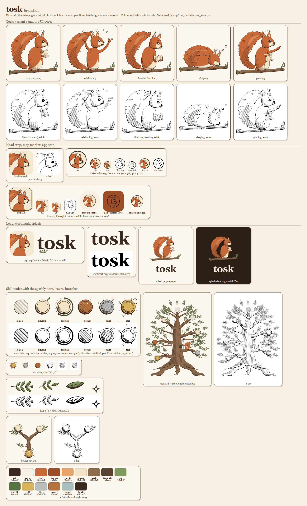

# tosk

A free, offline-first language-learning app with a strong focus on grammar and conjugation. Courses: Italian and Dutch (v1), Sarnami later. Tosk, the red squirrel (after Ratatosk), runs the course tree: each course is a branch with your skills as stone medallions, drawn in a storybook ink style that also works on e-ink. (The app was called tosk until v0.6; the repos and package ids keep that name for now, see `docs/brand-overhaul.md`.)



- Spec: [docs/SPEC.md](docs/SPEC.md)
- Architecture and contracts: [docs/ARCHITECTURE.md](docs/ARCHITECTURE.md)
- Backlog: [BACKLOG.md](BACKLOG.md)
- Content (CC BY-SA): the sibling repo `tosk-data`

## Status (v0.3.0, 14 October 2026)

| Course | Units | Skills | Taught words | Sentences | Notes |
| --- | --- | --- | --- | --- | --- |
| Italian (`it`) | 9 | 40 | ~740 | ~20,400 (2,200 generated) | bundled |
| Dutch (`nl`) | 8 | 35 | ~710 | ~16,300 (2,300 generated) | bundled |
| Sarnami (`hns`) | 9 | 35 | ~390 | ~3,000 | local-only (copyright), unverified, private importer (docs/private-importers.md) |

Course downloads (v0.4, in progress): the course picker lists the courses published on [tosk-data's GitHub Releases](https://github.com/linguaperta/tosk-data/releases) next to the bundled ones, with "Download" / "Update available", progress and cancel; the app checks at most once a day (Settings toggle) and never downloads without a tap. "Add course from file…" in the picker installs a local pack such as Sarnami. Publishing: [docs/release.md](docs/release.md#publishing-course-packs).

Tests: ~900 Flutter tests and 140 pipeline tests. Builds: Android APK, Windows and web. Release steps: [docs/release.md](docs/release.md).

## Layout

```
app/        Flutter app (Android, iOS, desktop, web)
pipeline/   Python: open data -> JSONL -> course.sqlite
schema/     JSON Schemas + compiled course DB DDL
docs/       spec and architecture
```

## Verify everything

```bash
./check.sh
```
